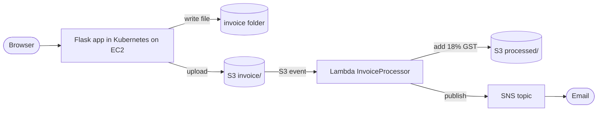

# Invoice Cloud Demo: Starter Project

A small web app used to practise the full cloud workflow: **Git, Docker, Kubernetes, AWS EC2, S3 and Lambda**.

When you click **Generate Invoice**, the app:

1. creates an invoice with a unique ID such as `INV-20261025-143205-7F3A`,
2. saves it as a JSON file in the `invoice` folder,
3. uploads the same file to an S3 bucket (once S3 is configured).

The upload triggers a Lambda function that adds 18% GST, writes a summary file back to S3 and sends an email notification.



## What is in this folder

| Path | Purpose |
|---|---|
| `app.py` | The Flask web app: creates invoices and uploads them to S3 |
| `templates/index.html` | The web page |
| `requirements.txt` | Python libraries the app needs |
| `Dockerfile` | Recipe for building the container image |
| `.dockerignore` | Files Docker leaves out of the image |
| `.gitignore` | Files Git does not track (generated invoices, virtual environment) |
| `invoice/` | Invoices are written here (empty at the start) |
| `k8s/invoice-app.yaml` | Kubernetes Deployment and Service |
| `lambda/lambda_function.py` | Lambda code: GST, summary file, email |
| `lambda/test-event.json` | Sample S3 event for testing Lambda in the AWS console |
| `aws/ec2-role-policy.json` | Permission for the EC2 server: upload to `invoice/` only |
| `aws/lambda-role-policy.json` | Permission for Lambda: read `invoice/`, write `processed/`, send email |

## Values you must replace

These placeholders appear in the files. Replace them with your own values when you reach the matching step.

| Placeholder | Replace with | Files |
|---|---|---|
| `DOCKERHUB_USERNAME` | Your Docker Hub username | `k8s/invoice-app.yaml` |
| `YOUR-BUCKET-NAME` | Your S3 bucket name | `k8s/invoice-app.yaml`, `aws/*.json`, `lambda/test-event.json` |
| `YOUR-ACCOUNT-ID` | Your 12 digit AWS account ID | `aws/lambda-role-policy.json` |

## Step 1: Accounts and tools

| You need | Check |
|---|---|
| VS Code (or any editor) | Open the app |
| Git | `git --version` |
| Python 3.10 or newer | `python3 --version` (Windows: `python --version`) |
| Docker Desktop, running | `docker run hello-world` prints **Hello from Docker!** |
| GitHub account | Sign in at github.com |
| Docker Hub account | Sign in at hub.docker.com |
| AWS account (for Steps 6 onward) | Sign in at console.aws.amazon.com, region **Asia Pacific (Mumbai) ap-south-1** |

## Steps 2 to 5

### Step 2: Git and GitHub

```bash
cd invoice_cloud_demo
git init -b main
git add .
git commit -m "First version of invoice cloud demo app"
```

Create an **empty public** repository named `invoice_cloud_demo` on GitHub (no README, no .gitignore, no license), then:

```bash
git remote add origin https://github.com/<github-username>/invoice_cloud_demo.git
git push -u origin main
```

### Step 3: Run the app on your laptop

macOS / Linux:

```bash
python3 -m venv .venv
source .venv/bin/activate
pip install -r requirements.txt
flask --app app run --port 8000
```

Windows (PowerShell):

```powershell
python -m venv .venv
.venv\Scripts\activate
pip install -r requirements.txt
flask --app app run --port 8000
```

Open http://localhost:8000, click **Generate Invoice**, then look inside the `invoice` folder. Stop with **Ctrl + C**.

On a Mac, port 5000 is used by AirPlay Receiver, which is why the app runs on port 8000 here.

### Step 4: Build and run with Docker

```bash
docker build -t invoice-app:v1 .
docker images invoice-app
docker run -d --name invoice-app -p 8080:5000 -v "$(pwd)/invoice:/app/invoice" invoice-app:v1
docker ps
```

Windows PowerShell: replace `$(pwd)` with `${PWD}`.

Open http://localhost:8080. **Served by** now shows the container ID. Then:

```bash
docker logs invoice-app
docker stop invoice-app
docker rm invoice-app
```

### Step 5: Push the image to Docker Hub

```bash
docker login
docker buildx build --platform linux/amd64,linux/arm64 -t <dockerhub-username>/invoice-app:v1 --push .
docker buildx imagetools inspect <dockerhub-username>/invoice-app:v1
```

The image is built for both `amd64` (cloud servers, most Windows laptops) and `arm64` (Apple silicon Macs), so it runs everywhere.

### Steps 6 to 12: AWS

Follow along with the class demo:

| Step | Topic |
|---|---|
| 6 | S3 bucket and IAM role for the server |
| 7 | Launch the EC2 server |
| 8 | Install K3s (Kubernetes) and deploy the app |
| 9 | SNS email topic |
| 10 | Lambda function and S3 trigger |
| 11 | Full run: generate an invoice, receive the email |
| 12 | Clean up so nothing is billed |

## Common problems

| Problem | Fix |
|---|---|
| `docker: command not found` | Start Docker Desktop, then open a new terminal. |
| `Cannot connect to the Docker daemon` | Docker Desktop is still starting; wait until it shows the engine is running. |
| `localhost:5000` shows 403 / AirTunes on a Mac | Use port 8000 as shown in Step 3. |
| `ModuleNotFoundError: No module named 'flask'` | Activate the virtual environment first. |
| `The container name "/invoice-app" is already in use` | `docker rm -f invoice-app`, then run again. |
| `port is already allocated` | Use another port, for example `-p 8081:5000`. |
| `git push` asks for a password | GitHub needs browser sign in or a personal access token, not your account password. |
| `denied: requested access to the resource is denied` on push | The image name must start with **your** Docker Hub username; run `docker login`. |
